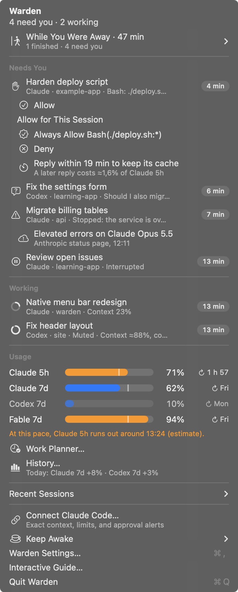

# Sessions and the menu

Click the lantern in the menu bar. Sessions waiting for you appear above running work, with usage readings and the controls you have chosen to show below.

<figure class="warden-menu-shot" markdown="span">

<figcaption>Sample sessions and quota readings. Answerable prompts also have buttons.</figcaption>
</figure>

## Read the lantern

The number counts sessions working or waiting for you. The lantern lights while agents work, shows an exclamation mark when a session needs you, and dims while alerts are snoozed.

**Settings → General** can add a usage percentage beside it: the fullest current limit or a limit you choose, shown as used or remaining.

## Find a session

| Section | What it tells you | What to do |
| --- | --- | --- |
| **Needs You** | Approvals, questions, failures, and interrupted turns; approvals first, then oldest waits | Answer a supported prompt or click to return to the agent |
| **Working** | Running sessions, context rings, turn duration, and active background agents | Click a local session to open its output |
| **Live Output** | Recent messages, commands, and tool results from active local Claude Code and Codex agents | Follow agents side by side or zoom one pane |
| **Recent Sessions** | Finished, paused, or ended sessions | Return to the session or resume it |
| **Usage** | Account and model limits, reset readings, and pace estimates | [Read the quota evidence](limits.md) |
| **Work Planner** | Observed constraints for a work period | [Review before more work](planner.md) |
| **History** | Usage, quota allocation, and activity reports | [Inspect local history](history.md) |

Session names come from Claude Code's title or session name and Codex's thread names. Without a title, a Claude session can use the start of its last prompt, kept in memory only; otherwise Warden shows the folder.

A session whose own turn ended stays under Working while its background agents work. A programmatic run such as `claude -p` or `codex exec` remains under Needs You only while its process runs; stopped runs move to Recent Sessions with their reason.

Saved Claude background jobs without recent conversation activity do not count as live sessions. Their saved blocked state can outlast the process.

## Follow live output

Click **Live Output…** in the lantern menu to open a window of read-only terminals, one for each active local session and available subagent. A background `codex exec` started by Claude Code is available here even without a terminal tab. Panes fill the window in balanced rows and keep their places. A pane that needs you has an orange outline.

Each pane reads like the agent's own command-line interface: its written updates with their formatting, lists, and links, below your latest prompt. A link to a document or an image opens it; other files and folders are shown in Finder. The line at the bottom shows the turn's running time and the latest command, or what the session is waiting for. New replies type in while **Follow Output** is on, and appear at once with macOS Reduce Motion enabled. After you scroll up to read, **Latest** returns to the newest output.

Commands and their output stay hidden until you ask for them. Click **Show commands** on a pane, or press ⌃O for every pane, to show them in order between the messages. To give one agent the whole window, click its zoom button, double-click its title, or press ⌘1 to ⌘9; press Esc or click **All Agents** to return. Warden keeps a bounded recent portion of each log in memory while the window is open. Where an interactive host exists, **Open Conversation** in the pane's **…** menu returns to it.

Use a running local Codex pane's **…** menu to stop its work. **Force Quit…** checks for a dedicated process that owns the session log. On a reachable shared Codex server, the confirmation offers **Stop Turn** for that conversation. **Dismiss Interrupted Session** clears an interrupted session from the live grid and Needs You until it records new activity.

## Return to the right terminal

Warden identifies the session's process from its bridge or open transcript. Terminal and iTerm select its tab. The [VS Code companion](connections.md#vs-code-companion) selects its integrated terminal and window. macOS asks once before Warden may control Terminal or iTerm.

Codex conversations started in the ChatGPT desktop app open their exact chat in that app.

Without a live host, Warden opens Terminal in the account and project folder with `claude --resume <session-id>` or `codex resume <session-id>`. Claude background sessions use `claude attach`. A click sends no new prompt. If Terminal cannot open, Warden offers to copy the resume command.

## Understand a wait

- **No new output** means the log has not changed for ten minutes. The agent may be running a long tool, reasoning, or waiting on a stalled request. Check its output or open its conversation. Esc in an interactive terminal stops the turn.
- A retry message, such as **Offline, retrying**, comes from the session's log.
- A Claude usage-limit wait shows the reported resume time. If the reset happens during a long sleep, Claude Code may wait for Enter instead.
- An interrupted turn stays under Needs You while the agent is open. Warden delays its alert by 30 seconds so you can redirect the agent after Esc.

See [Approvals and questions](prompts.md) for answer buttons and [Context and quotas](limits.md#prompt-cache) for cache deadlines.

## While You Were Away

After at least 15 minutes without keyboard or mouse input, or with the screen locked, Warden can show a summary when you return. It lists sessions that finished or need you, work and waiting time, and observed quota changes.

The summary stays at the top of the menu for half an hour and also sends a silent notification. Its submenu opens the session that waited longest. The absence start stays in memory only. Configure the summary in **Settings → General**.

## Widgets

Right-click the desktop, choose **Edit Widgets**, and search for **Warden**. Three sizes show waiting and working counts and the fullest limits, on the desktop or in Notification Center.

Click a session to bring it forward; click elsewhere to open the menu. Widgets show folder names, agent states, tool names, and limits, with no titles, commands, or questions. They refresh on changes and every quarter hour, and dim after half an hour without an update.

**Next:** [Approvals and questions →](prompts.md)
